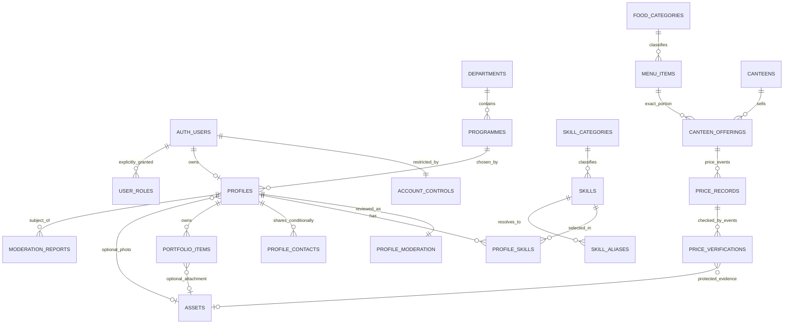

# C–D. Supabase data model, authorization, and privacy

Status: **Proposed, unexecuted design**. No SQL in this document has been installed or tested. The implementation agent must turn this contract into reviewed migrations and prove it against disposable local Supabase with ordinary application credentials.

## C. Recommended normalized Supabase schema

### Conventions and relationships

`public` is the deliberately exposed Data API schema. “Public schema” does **not** mean anonymous access. `private` is excluded from exposed schemas. Enable RLS on every application table, including private tables; combine policies with explicit grants. Private tables have no direct client grants and are accessed through narrowly authorized operations.

Conventions used in every table definition:

- Unless marked nullable (`?`), fields are `NOT NULL`.
- `id` means `uuid PRIMARY KEY DEFAULT gen_random_uuid()`, except profile/account IDs tied to Auth and the singleton configuration key.
- `created_at` is `timestamptz DEFAULT now()`, server assigned and immutable. Mutable tables also have `updated_at timestamptz DEFAULT now()` maintained by trusted database code. Append-only event tables have only their event timestamp, never an editable `updated_at`.
- UUID foreign keys use `ON UPDATE RESTRICT`. Delete actions are stated below; an unspecified relation is `ON DELETE RESTRICT`.
- Index every foreign key used for lookup/referential checks unless already the leading part of a primary/unique index. Extra indexes listed below serve actual filter/order/policy paths; measure before adding more.
- `key`/`name_key` means a stored normalized text key: Unicode normalization, whitespace trim/collapse and lower-case, preserving punctuation. Use one tested database normalization helper, with equivalent frontend suggestions; the database is authoritative. Declare it immutable only if its implementation actually is immutable.
- `seed_batch_id uuid? DEFAULT NULL` is a **server-controlled** sample marker on fixture-capable records. Non-null means fictional development data. Marker writes require the local development guard. It is never set from user metadata or a browser flag.
- Bounded text, finite numeric values and collection limits are checked in database functions/constraints. Reject PostgreSQL numeric `NaN`/infinities using finite upper/lower bounds, not only a `>= 0` test.
- Aggregate profile content writes and privileged management writes use controlled RPCs, not direct browser table writes. This deliberately protects administrative columns and multi-row state transitions.

**Data-origin contract:** `origin_is_allowed(batch_id)` reads the trusted singleton and allows unmarked records, or marked records only while that instance is development and seed-enabled; missing configuration fails closed. Caller controls and every target/reference root must pass this check, including owner/admin previews, private RPC projections and asset paths. Profile children inherit the profile's origin; profiles inherit the account marker; price/verification events inherit the offering marker. A genuine/unmarked root cannot reference a marked programme, skill, asset, canteen or menu item. Marked roots may reference unmarked shared catalogue rows or rows in their own batch, never a different batch. Multi-root records such as reports inherit any participating batch and reject conflicting batches. Guarded creation derives markers from the authenticated fixture account/parent or a separately guarded local operator registration; neither ordinary owners nor app admins may supply, clear or declassify markers. The local fixture administrator is itself a marked synthetic account, so its new catalogue/evidence records are labelled automatically. Audit events retain derived origin for safe labeling/filtering after target deletion. This is in addition to production seeding prevention, not a way to permit samples in production.



The diagram shows logical relationships, not all columns or nullable-delete cases. Audit targets intentionally do not have cascading foreign keys: their history must outlive removal of a target. Private actor UUIDs in append-only records identify the authenticated subject at the time of action and likewise may deliberately have no Auth FK to avoid mutating history on account erasure.

### C1. Academic and skill reference tables

#### `public.departments`

- **Purpose/classification:** Owner-approved academic reference data; non-sensitive catalogue. An administrator owns maintenance, not an individual student.
- **Columns:** `id`; `name text` (1–120); `key text`; `is_active boolean DEFAULT true`; `seed_batch_id?`; `created_at`; `updated_at`.
- **Constraints/indexes:** Unique `key`; nonblank normalized names; index `name_key` equivalent (`key`) for ordering and a trigram index if text search uses it. Names in the current demo are not imported as official data.
- **Delete:** Referenced departments cannot be deleted; retire them. Unreferenced mistaken rows may be removed through an audited admin operation.
- **Server-controlled:** IDs, normalized key, marker and timestamps; all maintenance admin-only.

#### `public.programmes`

- **Columns:** `id`; `department_id uuid FK departments`; `name text` (1–120); `key text`; `stage_unit text` (`semester`, `year`, `none`); `stage_count smallint?`; `is_active boolean DEFAULT true`; marker/timestamps.
- **Constraints:** Unique `(department_id, key)`. `stage_count IS NULL` for `none`; otherwise integer 1–20. Department is mandatory. No guessed IUST programme/duration rules.
- **Indexes:** `(department_id, is_active, key, id)`; trigram `key` if used in text search.
- **Delete/update:** Referenced programme deletion is restricted. Once used by profiles, changing department or stage interpretation requires an explicit audited migration/revalidation, not a silent dropdown edit. Retired programmes remain readable for existing/graduate records but cannot be newly selected on submission.
- **Ownership/privacy/control:** Shared non-sensitive reference; admin-controlled, including timestamps/marker.

#### `public.skill_categories`

- **Columns:** `id`; `name text` (1–80); `key text`; `display_order smallint DEFAULT 0`; `is_active boolean DEFAULT true`; marker/timestamps.
- **Constraints/indexes:** Unique `key`; bounded display order; `(is_active, display_order, id)` and trigram `key` as needed.
- **Delete/control:** Restrict deletion while skills/requests reference it; retire through audited admin operations. No category confers user permissions or superiority over others.

#### `public.skills`

- **Columns:** `id`; `category_id uuid FK skill_categories`; `name text` (1–80); `key text`; `is_active boolean DEFAULT true`; marker/timestamps.
- **Constraints/indexes:** Globally unique canonical `key`; `(category_id, is_active, key, id)`; GIN trigram index on `key`.
- **Delete/control:** Restrict referenced deletion. Admin-only create/update/merge/retire. Students select IDs, not authoritative free text. Canonical/alias namespace collision checks run under the same advisory lock for all taxonomy writes.
- **Relationship:** One primary category per skill, many profiles per skill. Multiple category memberships are postponed until actual taxonomy needs justify another junction table.

#### `public.skill_aliases`

- **Columns:** `id`; `skill_id uuid FK skills`; `alias text` (1–80); `key text`; marker/timestamps.
- **Constraints/indexes:** Unique `key`; index `(skill_id, key)`; trigram `key`. A key cannot equal another skill's canonical key or an existing alias; an alias equal to its own canonical name is rejected as redundant.
- **Delete/control:** Admin operations only; skill deletion restricted until aliases are explicitly reassigned/removed. Merge operations reassign profile links with duplicate prevention and preserve useful aliases.

#### `private.skill_requests`

- **Purpose:** Missing terms need a review queue rather than uncontrolled canonical duplicates.
- **Columns:** `id`; `requester_id uuid FK auth.users`; `proposed_name text` (1–80); `key text`; `suggested_category_id uuid? FK skill_categories`; `status text DEFAULT 'pending'` (`pending`, `accepted`, `merged`, `rejected`); `resolved_skill_id uuid? FK skills`; `resolution_reason text?` (max 500, requester-safe); `reviewed_by uuid?`; `reviewed_at timestamptz?`; `request_id uuid`; marker/timestamps.
- **Constraints/indexes:** Unique `(requester_id, request_id)`; partial unique `(requester_id, key) WHERE status='pending'`; accepted/merged require resolved skill and review metadata; pending forbids final review metadata. Index `(status, created_at, id)` and requester/time.
- **Ownership/privacy:** Requester sees only their requests via a safe RPC; admin sees the queue. Requester cannot choose status/resolution/actor. Max five new requests per day and ten open per requester, checked while holding the account lock.
- **Delete:** No client hard delete; privileged retention/cleanup handles requester deletion explicitly. Shared taxonomy is not deleted with a request.

### C2. Account, profile, ownership, and moderation tables

#### `private.account_controls`

- **Purpose:** Persistent account restriction/eligibility, independent of the existence or content of a profile.
- **PK/FK:** `user_id uuid PRIMARY KEY REFERENCES auth.users(id) ON DELETE RESTRICT`. A trusted signup trigger creates exactly one row with safe defaults. No client chooses its owner.
- **Columns:** `account_status text DEFAULT 'active'` (`active`, `suspended`, `closed`); `eligibility_status text DEFAULT 'pending'` (`pending`, `eligible`, `ineligible`); `eligibility_basis text?` (bounded method description, no identity-certification claim); `eligibility_key_hash text?`; `eligibility_decided_by uuid?`; `eligibility_decided_at timestamptz?`; `owner_reason text?` (max 500); `staff_note text?` (max 2,000); `close_requested_at timestamptz?`; marker/timestamps.
- **Constraints:** Partial unique non-null `eligibility_key_hash`. Use only if the owner chooses a legitimate stable eligibility identifier; derive a keyed hash server-side rather than storing/raw-exposing an institutional ID. Non-pending eligibility requires decision metadata. Record changes through audited operations.
- **Indexes:** `(account_status, eligibility_status, user_id)` plus the unique hash index; PK supports all owner/role checks.
- **Privacy/control:** Private; owner summary RPC omits hash/staff notes and returns only their safe state/reason. Every field is server-controlled. Email confirmation is read from Auth, not duplicated into a user-editable field.
- **Delete:** No ordinary delete. Suspension cannot be bypassed through profile removal/recreation. Closing retains this row/tombstone until the approved purge process. Reliable prevention of a person registering a different identity requires the owner's real eligibility/deduplication policy; do not pretend a UUID alone solves that.

#### `public.profiles`

- **PK/FK/ownership:** `id uuid PRIMARY KEY REFERENCES auth.users(id) ON DELETE RESTRICT`; no separate mutable `user_id`. Therefore one account can own at most one profile and `id = auth.uid()` for owner operations.
- **Editable content columns:** `display_name text DEFAULT ''` (max 80); `programme_id uuid? FK programmes`; `member_type text DEFAULT 'student'` (`student`, `graduate`); `stage_number smallint?`; `graduation_year smallint?`; `bio text DEFAULT ''` (max 280); `about text DEFAULT ''` (max 2,000); `services text DEFAULT ''` (max 500); `interests text[] DEFAULT '{}'` (max ten, max 60 characters each).
- **Sharing/assets:** `discovery_opt_in boolean DEFAULT false`; `photo_asset_id uuid? FK private.assets`; `photo_audience text DEFAULT 'owner'` (`owner`, `campus`). FK deletion restricted; detach first through a controlled operation.
- **Server-only columns:** `name_key text` derived from name; `write_version bigint DEFAULT 1`; `content_version bigint DEFAULT 1` (both positive; `write_version >= content_version`); `featured_rank smallint?` (1–3 when set); marker/timestamps. Featured rank does not bypass the visibility predicate; admin controls it independently from content review.
- **Constraints:** Drafts may have missing name/programme/bio/stage, but not oversized or structurally invalid data. A graduate's stage must be null; a student's graduation year is null in v1. Submission checks valid programme/stage/current-year/graduation rules, required name/bio/skills, approved input shapes and ready owned assets. Cross-table constraints are enforced by guarded operations/triggers, not an invalid cross-table `CHECK` assumption.
- **Indexes:** `(name_key, id)` for cursor order; `(programme_id, member_type, stage_number, id)`; `(member_type, graduation_year, id)`; optional small spotlight index; trigram indexes on name and relevant profile text expression after measuring plans. Ref table and junction indexes support relational search without a stale copied skills array.
- **Privacy:** Only directory-safe content lives here. Owning a row permits a preview, not automatic discovery. `photo_asset_id` is not a download capability. Contact values, staff notes, eligibility identifiers and audit actors are elsewhere.
- **Delete:** No direct client deletion. Soft removal lives in moderation. A privileged purge must detach assets/delete owned children and handle reports/controls before root/Auth deletion; retain restrictions according to the decided policy.

#### `private.profile_moderation`

- **PK/FK:** `profile_id uuid PRIMARY KEY REFERENCES public.profiles(id) ON DELETE CASCADE`. Cascade is only reachable through an authorized hard purge, not a client operation.
- **Columns:** `status text DEFAULT 'draft'` (`draft`, `submitted`, `approved`, `rejected`, `removed`); `submitted_version bigint?`; `submitted_at timestamptz?`; `reviewed_version bigint?`; `reviewed_at timestamptz?`; `reviewed_by uuid?`; `owner_reason text?` (max 500); `staff_note text?` (max 2,000); `removed_at timestamptz?`; timestamps.
- **Constraints/indexes:** Versions positive; submitted needs submitted version/time matching `profiles.content_version`; approval requires reviewed version equal to current content version, enforced with the parent lock; rejection needs an owner-safe reason; removed needs removal time. `expected_version` always checks `profiles.write_version`, including for admin review. Index `(status, submitted_at, profile_id)`.
- **Ownership/privacy/control:** One current moderation record, no revision copies. All fields server-controlled. Own-status RPC omits staff notes/other people's data. Admin review reads include permitted private details. A version counter is concurrency control, not an elaborate revision system.
- **Lifecycle:** Every ordinary content-mutating path—including child writes and asset replacements—uses the same parent lock/reset rule: increment `write_version` and `content_version`, clear current submission/review fields and return to draft. Submitted content is immutable until withdrawal, apart from exposure-only reductions. The narrowly typed privacy operation increments only `write_version`, preserving submitted/reviewed content-version metadata; it permits campus → owner, discovery hiding, and optional asset detachment that leaves valid rows. Re-listing unchanged approved content also changes only `write_version`; audience widening requires content review. Moderation/account transitions affecting a profile and spotlight changes increment `write_version` without pretending content was newly reviewed. Suspension lives in account controls, not this editable content model.

#### `public.profile_skills`

- **Columns/key:** `profile_id uuid FK profiles ON DELETE CASCADE`; `skill_id uuid FK skills ON DELETE RESTRICT`; composite PK `(profile_id, skill_id)`; `created_at`.
- **Indexes:** Reverse `(skill_id, profile_id)` for skill filters; PK handles owned aggregate reads. No copied skill names or arbitrary category strings.
- **Ownership/privacy/control:** Inherits profile access. Changes only within parent-authorized/version-checked writes, never direct REST. Enforce at most 20 per profile under a parent lock; new associations require active skills.
- **Timestamp/delete:** Association identity is immutable; deleting/re-adding a genuine association creates a new created time. Taxonomy merges lock affected profiles in a consistent order, deduplicate links, advance both profile counters, and return affected submitted/approved/rejected content to draft. An administrator records the reason; no silent child-only version bypass.

#### `public.profile_contacts`

- **Columns:** `id`; `profile_id uuid FK profiles ON DELETE CASCADE`; `kind text` (`email`, `phone`, `social`, `website`); `label text DEFAULT ''` (max 60); `value text` (kind-specific maximum, never over 2,048); `audience text DEFAULT 'owner'` (`owner`, `campus`); timestamps.
- **Constraints/indexes:** Unique `(profile_id, kind, value)`; `(profile_id, audience, id)`; max ten contacts per profile under the parent lock. Validate email/phone syntactically without asserting identity; social/site values must be HTTPS URLs without credentials/control characters. Render `mailto:`/`tel:` only from validated contact values, not arbitrary supplied URI schemes.
- **Privacy:** Each row has one visibility decision. Owner SELECT is allowed; another eligible reader receives only campus rows of a discoverable profile. Direct admin SELECT does not automatically expose owner-only contacts; audited profile-inspection RPC is the exceptional admin path. No private values fetched then hidden with CSS.
- **Writes:** Owned aggregate/explicit privacy RPC. Content edits follow re-review rules; narrowing audience can apply immediately. Owner, creation timestamp and ID are immutable.

#### `public.portfolio_items`

- **Columns:** `id`; `profile_id uuid FK profiles ON DELETE CASCADE`; `title text` (1–100); `description text DEFAULT ''` (max 1,000); `external_url text?` (max 2,048, HTTPS only); `asset_id uuid? FK private.assets ON DELETE RESTRICT`; `audience text DEFAULT 'campus'` (`owner`, `campus`); `sort_order smallint DEFAULT 0`; timestamps.
- **Constraints:** At least description, link or attachment; sort order 0–100; max ten rows per profile under the parent lock. Asset must be ready, portfolio-purpose and owned by this profile's Auth subject. Reject IDs belonging to another owner and unknown administrative payload keys.
- **Indexes:** `(profile_id, sort_order, id)`; partial index on non-null `asset_id` for authorization/reference cleanup.
- **Privacy/control:** Parent visibility plus per-entry audience. Owner and authorized reviewing admin can preview; others see campus entries only when the parent is discoverable. Counts/links use that same predicate. New/default campus sharing is explained at submission.
- **Delete:** Remove an entry through parent aggregate write, resetting review as needed; detach/mark unreferenced assets. Stable IDs survive ordinary edits/reordering, preserving React keys.

### C3. Assets, reports, roles, and audit

#### `private.assets`

- **Purpose:** Trusted lifecycle metadata coordinates Storage bytes with relational references, validates ownership/purpose, and supports retry/orphan recovery.
- **Columns:** `id`; `owner_id uuid? FK auth.users ON DELETE SET NULL`; `purpose text` (`photo`, `portfolio`, `price_evidence`); `state text DEFAULT 'reserved'` (`reserved`, `processing`, `ready`, `rejected`, `delete_pending`, `deleted`); `quarantine_path text`; `bucket_id text?`; `object_path text?`; `media_type text?`; `byte_size bigint?`; `width integer?`; `height integer?`; `sha256 text?`; `expires_at timestamptz` (reservation creation + 10 minutes); `processing_token uuid?`; `processing_expires_at timestamptz?`; `validated_at timestamptz?`; `failure_code text?` (sanitized); marker/timestamps.
- **Constraints/indexes:** Unique quarantine path; partial unique `(bucket_id, object_path)` for final paths. Processing requires a server-created token and bounded lease expiry; only the current token may finalize/retry that work. A ready row requires immutable final path, allowed media type, positive bounded bytes/dimensions/hash and validation time. Photo/portfolio final bucket is `profile-media`; evidence bucket is `verification-evidence`. Index `(owner_id, state, created_at)` and `(state, expires_at, id)`; cleanup also checks processing expiry and actual references.
- **Ownership/path:** Reservation always assigns a non-null current Auth owner; ordinary APIs cannot create ownerless assets, clear ownership or transfer it. Null is only for attribution after an approved Auth purge, allowing retained evidence/tombstone metadata to outlive its uploader. Personal assets are detached/cleaned before that purge; retained evidence remains accessible only through admin/verification authorization. Quarantine path `<owner UUID>/<asset UUID>/source`; final path `<owner UUID>/<asset UUID>/image.webp`. Path text is generated by trusted code. Do not use user filenames, names, emails or free-form destinations as authority.
- **Control/privacy:** No client table grants. Reservation inputs are only declarations; trusted processing determines actual bytes/type/hash/state. User cannot mark an object ready. Asset gateways use referenced profile/portfolio/verification parent state for access, not path secrecy.
- **Delete:** Do not cascade-delete bytes or referenced metadata. Detach first; a service-only cleanup deletes actual objects through the Storage API and marks metadata deleted. Retain tombstone metadata when price-history references require it. Cleanup excludes currently referenced ready assets and active reservations/processing leases; ready-unattached assets become reclaimable after 24 hours. Attachment and cleanup lock the asset row so an object cannot become newly attached after it enters `delete_pending`.

#### `private.moderation_reports`

- **Columns:** `id`; `reporter_id uuid? FK auth.users ON DELETE SET NULL`; `profile_id uuid? FK profiles ON DELETE SET NULL`; `target_subject uuid` (original target, immutable, deliberately retained without FK); `category text` (`spam`, `harassment`, `impersonation`, `other`); `description text` (1–1,000); `status text DEFAULT 'open'` (`open`, `resolved`, `dismissed`); `resolution_summary text?` (max 500, reporter-safe); `staff_note text?` (max 2,000); `resolved_by uuid?`; `resolved_at timestamptz?`; `request_id uuid`; marker/timestamps.
- **Constraints/indexes:** Unique `(reporter_id, request_id)`; partial unique `(reporter_id, profile_id) WHERE status='open'`; reporter/target must exist at creation, cannot be the same person. Final status requires resolution actor/time/reason. Index `(status, created_at, id)` and `(reporter_id, created_at, id)`.
- **Access/control:** Active eligible users (or active admins acting as readers) can report a currently discoverable profile; max five new reports per day under a per-account lock. Reporter reads their own receipt/status/safe summary via RPC, including after suspension. Subjects cannot read reports against them or reporter identities, including when the subject is an admin. Admin report queues/private inspections and related audit projections exclude that subject; another administrator handles the case. Admins cannot resolve their own submitted reports. No arbitrary client status changes/deletions.
- **Retention:** No client hard delete. Purge may pseudonymize/remove sensitive narrative on the approved schedule while retaining a minimal action audit.

#### `private.user_roles`

- **Columns/key:** `user_id uuid FK auth.users ON DELETE RESTRICT`; `role text` (`admin`, `role_manager`); composite PK `(user_id, role)`; `granted_at timestamptz DEFAULT now()`; `granted_by uuid?` (null for an identified operator bootstrap).
- **Purpose:** Explicit application authority. Ordinary students need no role row. `role_manager` is separate and does not implicitly grant content-administration rights.
- **Indexes:** PK supports role checks; `(role, user_id)` supports authorized role-management lists/last-manager protection.
- **Control:** No client DML or metadata-based provisioning. The first named confirmed account receives both roles through approved operator SQL/script plus an audit event. Subsequently only an active confirmed role manager can grant/revoke allowed roles. Shared advisory lock protects against concurrent removal/suspension/closure of the last active role manager.
- **Deletion/privacy:** Role revocation is a controlled DELETE with an immutable audit event; role rows are current grants, not the history log. A user may get their own role summary; admin/role-manager list projections are bounded. Auth hard deletion first revokes roles explicitly.

#### `private.admin_audit_log`

- **Columns:** `id`; `request_id uuid UNIQUE`; `actor_kind text` (`user`, `operator`, `system`); `actor_user_id uuid?`; `actor_label text?` (bounded operator/job identifier, not a claimed human identity); `action text` (allowlisted); `target_table text` (allowlisted); `target_key text`; `occurred_at timestamptz DEFAULT clock_timestamp()`; `reason text?` (max 500); `details jsonb DEFAULT '{}'`; `seed_batch_id uuid?` derived by trusted code.
- **Actor/target references:** No cascading FKs by design. Actor UUID comes from authenticated context at execution, not the browser; target identifiers survive removal. An operator event identifies the database/operator context and its approved runbook action rather than fabricating an Auth actor.
- **Constraints:** Actor-kind consistency; details are a small allowlisted projection generated by trusted code, not arbitrary client JSON. Only necessary state/field changes, price values, IDs and reasons; no passwords, tokens, raw documents, private contact snapshots or needless personal information.
- **Indexes:** `(occurred_at DESC, id)`; `(target_table, target_key, occurred_at DESC)`; `(actor_user_id, occurred_at DESC)`.
- **Access:** No application INSERT/UPDATE/DELETE grants. Audited operations append the record transactionally; a failure rolls back both. Admins can read bounded relevant projections, and role managers can read role-management audit entries. Privileged retention jobs, not app roles, implement an approved retention policy.

### C4. Canteen catalogue and immutable history

#### `public.food_categories`

- **Columns:** `id`; `name text` (1–80); `key text UNIQUE`; `display_order smallint DEFAULT 0`; `is_active boolean DEFAULT true`; marker/timestamps.
- **Ownership/access:** Admin-managed catalogue, eligible-reader SELECT. No university-specific category claims are assumed.
- **Indexes/delete:** `(is_active, display_order, id)`; restrict referenced deletion, retire instead. Server controls IDs/keys/markers/timestamps.

#### `public.menu_items`

- **Purpose:** One exact canonical food-item/variant/portion identity that can be compared without conversion.
- **Columns:** `id`; `food_category_id uuid FK food_categories`; `name text` (1–120); `name_key text`; `variant text DEFAULT ''` (max 80); `variant_key text`; `serving_quantity numeric(10,3)?`; `unit_code text?` (`piece`, `g`, `ml`, `portion`); `portion_spec text DEFAULT ''` (max 200); `portion_key text`; `is_comparable boolean DEFAULT false`; `is_active boolean DEFAULT true`; marker/timestamps.
- **Constraints:** Finite quantity >0 and within numeric bounds when supplied. Comparable requires quantity and unit; `portion` additionally requires an explicit shared portion specification. Unknown size/unit remains non-comparable. Unique normalized identity `(name_key, variant_key, serving_quantity, unit_code, portion_key)` using `NULLS NOT DISTINCT` on supported PostgreSQL, or an equivalent tested unique expression. Category changes must not create duplicate identities.
- **Indexes:** `(food_category_id, is_active, name_key, id)`; trigram name/variant key search. Verify the local/project PostgreSQL version before using version-specific SQL.
- **Delete/update:** Restrict deletion while referenced by offerings. Once an offering has price history, identity-defining variant/quantity/unit/spec changes create a new item and offering, not reinterpret historical comparisons. Admin can fix display-only spelling through an audited operation.
- **Privacy/control:** Catalogue data; every write/comparability assertion admin-only. No fabricated equivalence or conversions.

#### `public.canteens`

- **Columns:** `id`; `name text` (1–120); `key text UNIQUE`; `location_description text DEFAULT ''` (max 300); `is_active boolean DEFAULT true`; marker/timestamps.
- **Constraints/indexes:** Nonblank name; `(is_active, key, id)`.
- **Ownership/access/delete:** Admin-managed, active eligible-reader view; admins inspect archived rows. Referenced deletion restricted; archive instead. Names/locations require authorized real sources or explicit fictional fixtures.

#### `public.canteen_offerings`

- **Purpose:** Essential junction between a seller and an exact comparable product. Availability/currency/history belong to this relationship, not the generic food item.
- **Columns:** `id`; `canteen_id uuid FK canteens`; `menu_item_id uuid FK menu_items`; `canteen_item_label text DEFAULT ''` (max 120); `currency text DEFAULT 'INR'`; `is_available boolean DEFAULT false`; `availability_checked_at timestamptz?`; `is_active boolean DEFAULT true`; marker/timestamps.
- **Constraints:** Unique `(canteen_id, menu_item_id, currency)`; uppercase three-letter currency and v1 allowlist `INR` pending owner decision. Marking available requires a server-recorded check time. Identity/currency cannot change after price history exists.
- **Indexes:** `(menu_item_id, currency, is_active, canteen_id)`; `(canteen_id, is_active, id)`.
- **Access/delete/control:** All writes admin-only and audited. Eligible readers may see active unavailable offerings with a clear unavailable label. Referenced deletion restricted; availability/retirement does not delete historical prices.

#### `private.price_records`

- **Columns:** `id`; `sequence bigint GENERATED ALWAYS AS IDENTITY UNIQUE`; `offering_id uuid FK canteen_offerings`; `event_kind text` (`set`, `withdraw`); `amount numeric(10,2)?`; `recorded_at timestamptz DEFAULT clock_timestamp()`; `recorded_by uuid`; `corrects_price_id uuid? FK price_records`; `source_note text?` (max 500, admin-private); `request_id uuid`; `seed_batch_id?`.
- **Constraints:** Set events require finite `0 <= amount <= 99999999.99`; validate at most two decimal places before coercing to `numeric(10,2)` so PostgreSQL cannot silently round an invalid price. Zero explicitly means free, not unknown. Withdraw events require null amount and a reason in the audited operation. Unique `(offering_id, request_id)`. Correction points to a pre-existing current record of the same offering; verify with an offering lock, preventing cross-offering/cyclic references. Actor/time/sequence/marker are trusted, never payload-controlled.
- **Time semantics:** v1 events become effective on recording. `recorded_at` is both recording and activation time, so there is no redundant editable effective-time field. Reject future/backdated activation parameters. Observation time belongs to verification. Future scheduling needs a separately reviewed schema/query extension.
- **Indexes:** `(offering_id, recorded_at DESC, sequence DESC)` covering event kind/amount; correction FK index. Sequence is a deterministic tie-breaker, not a user-visible total-user limit.
- **History/delete:** Append-only for application operations. No UPDATE/DELETE, including admin table access. Latest `(recorded_at, sequence)` wins. A latest withdrawal means no current price, with no fallback. Older events remain historical/superseded. Roots and corrections use restricted deletion; only local sample cleanup or an explicit privileged retention plan may remove marked historical events.
- **Privacy:** Current safe projections omit actor UUID, source note and request ID. Admin history RPC can inspect them. `recorded_by` has no mutating Auth FK so immutable history survives account deletion; its trusted insertion establishes provenance.

#### `private.price_verifications`

- **Columns:** `id`; `sequence bigint GENERATED ALWAYS AS IDENTITY UNIQUE`; `price_record_id uuid FK price_records`; `decision text` (`verified`, `revoked`); `recorded_at timestamptz DEFAULT clock_timestamp()`; `observed_at timestamptz?`; `actor_user_id uuid`; `source_method text?` (bounded allowlist such as displayed-menu inspection or authorized supplier confirmation; fixtures explicitly simulated); `evidence_asset_id uuid? FK assets`; `reason text` (max 500); `request_id uuid`; `seed_batch_id?`.
- **Constraints:** Verified needs observation time not in the future, a method and ready evidence of purpose `price_evidence`; source observation may precede data entry. Revoke requires a reason and need not add evidence. Unique `(price_record_id, request_id)`. Every event references the exact price, not merely the offering. First-release verification must target the current set-price event under an offering lock.
- **Indexes:** `(price_record_id, recorded_at DESC, sequence DESC)`; evidence FK index for access/cleanup.
- **Control/history:** Append-only via admin operation with same-transaction audit. Latest event for a price determines verification state; a revoke must not fall back to an earlier verify event. A new price starts with no verification. Actors are immutable trusted subjects without a mutating Auth FK.
- **Evidence/privacy/delete:** Raw evidence/path/private notes are admin-only. Do not delete referenced evidence metadata; retain a tombstone and explicitly show when old supporting evidence has been retired. Current eligible verification requires ready evidence; cleanup never silently removes current supporting objects. Historical price/verification records remain.

### C5. Trusted environment and local fixture metadata

#### `private.instance_config`

- **Purpose:** A small trusted singleton supplies seed-target identity and price freshness policy; a frontend flag is insufficient.
- **Columns:** `singleton boolean PRIMARY KEY DEFAULT true CHECK(singleton)`; `instance_id uuid DEFAULT gen_random_uuid() UNIQUE`; `environment text DEFAULT 'production'` (`production`, `development`); `seed_enabled boolean DEFAULT false`; `stale_after_days smallint DEFAULT 7`; timestamps.
- **Constraints:** Staleness 1–90 days; production implies seed disabled. Before switching to production, a trusted operation verifies there are no marked sample records/accounts. Restrict environment changes to approved operator tooling, not admin/browser RPCs. A default production row fails closed until a disposable local instance is explicitly provisioned as development.
- **Access/control:** No client grants. A safe configuration RPC may expose the comparison threshold, not operator control fields. Admin may change only staleness through an audited operation; only operators may set environment/seed enablement/instance identity.
- **Delete:** No application deletion. One checked instance identity links the seed script's API and database targets.

#### `dev_only.seed_registry` — local auxiliary table, not a production migration

- **Purpose:** Map deterministic fixture keys to Auth-generated UUIDs, for resumable seed/cleanup without relaxing real ownership constraints.
- **Columns:** `seed_key text PRIMARY KEY`; `batch_id uuid`; `auth_user_id uuid UNIQUE`; `synthetic_email text UNIQUE`; `fixture_hash text`; `instance_id uuid`; `created_at timestamptz DEFAULT now()`.
- **Control:** Created by the guarded local script only after validating loopback API/database and the development instance. No exposed schema, no client grants; RLS enabled. No Auth FK that prevents recovering a partially completed local cleanup. Script must verify actual Auth UUID/email/protected seed marker before acting.
- **Delete:** Only exact batch/key cleanup. Never infer deletability from a name or an email substring.

These additional tables each close a concrete gap: account restrictions, private moderation, granular contact visibility, taxonomy aliases/requests, asset recovery, reports, role history, seller-product identity and price-specific verification. No chat/order/event/business-workflow tables are part of v1.

### C6. Current-price derivation and search indexes

The following is **illustrative SQL inside an already authorized operation**, not an executable migration or a complete endpoint. Named placeholders stand for validated parameters. A production implementation must add approved filters, limits, cursor validation and function grants.

```sql
-- PROPOSED / NOT EXECUTED. Authorize eligible reader/admin before this query.
with clock as (
  select statement_timestamp() as as_of,
         make_interval(days => c.stale_after_days) as freshness
  from private.instance_config c
  where c.singleton
), latest_price as (
  select distinct on (p.offering_id) p.*
  from private.price_records p
  order by p.offering_id, p.recorded_at desc, p.sequence desc
), latest_verification as (
  select distinct on (v.price_record_id) v.*
  from private.price_verifications v
  order by v.price_record_id, v.recorded_at desc, v.sequence desc
), current_rows as (
  select o.id as offering_id, o.menu_item_id, o.currency,
         c.name as canteen_name, c.key as canteen_sort,
         p.id as price_id, p.event_kind, p.amount, p.recorded_at,
         v.decision as verification_status,
         v.recorded_at as verification_event_at,
         case when v.decision = 'verified' then v.recorded_at end as verified_at,
         v.observed_at, o.seed_batch_id is not null as is_sample,
         o.is_available, m.is_comparable,
         coalesce(
           p.event_kind = 'set' and o.is_available and m.is_comparable
           and v.decision = 'verified' and a.state = 'ready'
           and v.observed_at >= clock.as_of - clock.freshness
           and v.observed_at <= clock.as_of,
           false
         ) as eligible
  from public.canteen_offerings o
  join public.canteens c on c.id = o.canteen_id
  join public.menu_items m on m.id = o.menu_item_id
  join public.food_categories f on f.id = m.food_category_id
  left join latest_price p on p.offering_id = o.id
  left join latest_verification v on v.price_record_id = p.id
  left join private.assets a on a.id = v.evidence_asset_id
  cross join clock
  where o.is_active and c.is_active and m.is_active and f.is_active
    and private.origin_is_allowed(o.seed_batch_id)
    and private.origin_is_allowed(c.seed_batch_id)
    and private.origin_is_allowed(m.seed_batch_id)
    and private.origin_is_allowed(f.seed_batch_id)
    and private.origin_is_allowed(p.seed_batch_id)
    and private.origin_is_allowed(v.seed_batch_id)
    and private.origin_is_allowed(a.seed_batch_id)
  -- Apply validated canteen/category/item/currency filters here.
), filtered as (
  select * from current_rows
  where (:max_budget is null or amount <= :max_budget)
  -- Optional availability/status filters affect this current-result set only.
), ranked as (
  select *, min(amount) filter (where eligible)
    over (partition by menu_item_id, currency) as lowest_eligible_amount
  from filtered
)
select offering_id, menu_item_id, currency, canteen_name, price_id,
       amount, recorded_at, verification_status, verification_event_at,
       verified_at, observed_at, is_sample,
       is_available, is_comparable, eligible,
       eligible and amount = lowest_eligible_amount as is_lowest
from ranked
-- Apply cursor AFTER grouped minimum; cap page size at 50.
order by amount asc nulls last, canteen_sort asc, offering_id asc
limit :bounded_page_size;
```

The current selection precedes budget and verification eligibility; it therefore cannot select an older cheap/verified record. Origin checks apply after latest-event selection as well: an invalid latest event cannot reveal an older allowed event as current. A no-price/withdrawn offering remains unknown unless a new set event is recorded. Sorting descending uses an allowlisted SQL ordering path, never interpolated user SQL; keep unknown amounts last in both directions. Page size defaults to 20 and is capped at 50, with a validated cursor over amount/null position, canteen key and offering ID bound to the current filters/order. If several item groups are returned, each has its own minimum. Return safe explanation codes for excluded/ineligible states; no evidence paths or actor UUIDs in this projection. A revocation's event time is not labelled as a verification time.

Profile search similarly builds one visible profile candidate set with `EXISTS` for selected skills/categories and text aliases, applies the stable `(name_key, id)` cursor, then aggregates only authorized children. Maintain GIN `pg_trgm` indexes on normalized names/aliases/search text and B-tree indexes on membership/filter keys. Parameter bounds and API statement timeouts are required: a LIMIT alone does not bound a query's work. Confirm plans with representative data; short literals and punctuation may need the exact skill-ID path.

### C7. Deletion and retention contract

- **Application removal:** Soft-remove a profile, suspend/close an account, retire taxonomy/canteens/offerings, and append price withdrawals. These preserve ownership restrictions and history.
- **Restoration:** Authorized admin returns removed content/restored suspended accounts to draft, preserving rejection/removal history in the audit. There is no public toggle that restores approval or clears a restriction.
- **Permanent deletion:** Separate privileged, explicitly approved operator procedure. Detach and delete Storage objects using the Storage API, scrub private content/contacts, handle report references and role grants, then handle profile/Auth records in FK order. A same-account ban tombstone remains while justified by the decided policy. Do not provide an ordinary arbitrary hard-delete RPC.
- **Recommended retention for owner approval:** Soft-removed personal content up to 30 days before purge; minimal moderation/audit records 180 days; price history for the lifetime of the service; superseded verification evidence 90 days after last relevant use, preserving current evidence and explicitly recording retirement. These are proposed operational defaults, not legal claims or automatic jobs authorized by this review.
- **Blocker before genuine production enrollment:** Confirm retention, account erasure and eligibility-ban/deduplication requirements. Minimal pseudonymous restriction data and complete erasure can conflict; the owner must choose a defensible policy. No promise to recognize a human across unrelated new accounts without a verified identifier.

## D. Authorization and RLS design

### D1. Principals and shared predicates

Use database-current facts, not editable user metadata or stale client role state:

| Symbol | Exact meaning |
| --- | --- |
| `anon` | No signed-in Supabase user. No member directory, contacts, private Storage or canteen data under the campus-only default. Public frontend assets/marketing are separate. |
| `R` | Signed-in, current confirmed-email user whose control row exists, account is not closed and caller origin is allowed. Includes pending/ineligible and suspended users for non-sensitive reference reading. |
| `O` | `R` and the target profile ID equals `auth.uid()`. Permits retained own-data reads, including during suspension. |
| `W` | `O`, account active, profile not removed, and edit-state/version requirements satisfied. Draft editing is allowed while eligibility is pending/ineligible; submission additionally disallows ineligible status. |
| `A` | Current confirmed-email, active account with allowed caller origin and a current `user_roles(admin)` row. No implicit role from being authenticated, an email string, or Auth user metadata. |
| `M` | Current confirmed-email, active account with allowed caller origin and a current `user_roles(role_manager)` row. Not automatically `A`. |
| `C` | Current confirmed-email active eligible reader, or `A`. This is the campus-reader gate. |
| `V(p)` | Target has confirmed email, active/eligible account, moderation approved at its current content version, discovery opt-in and permitted data origin. |

All subject/role helpers use `auth.uid()` internally and reject a missing control row. Client-supplied IDs can identify a target but never substitute for the actor. Closed accounts can read only a minimal account-state/recovery response through an explicitly scoped RPC; suspended users have own read/reference/receipt access but no ordinary content, report, upload or canteen writes.

Private role/account helpers can avoid recursive RLS by reading their protected tables as the trusted function owner. Keep dependency direction simple: role helpers read Auth/roles/controls; the visibility helper reads profile/moderation/controls; child policies call visibility helpers. Do not build mutually recursive policies between profiles, controls and roles. Tests must demonstrate no recursion (`42P17`) and fail-closed missing state.

### D2. Complete operation-level access matrix

**Direct table access through REST/SQL application roles:** `—` means no grant (and no permitting policy). Neither students nor administrators receive a privileged browser key. App admins are still PostgreSQL `authenticated`, so admin *write* authority exists only in the guarded operations in the last column. `service_role`/operator credentials are outside this matrix and must remain trusted/server-only.

| Table | SELECT for `anon` | SELECT for `authenticated` | Direct INSERT | Direct UPDATE | Direct DELETE | Guarded write/read interface |
| --- | --- | --- | --- | --- | --- | --- |
| `public.departments` | — | `R` reference rows | — | — | — | `A` audited catalogue create/edit/retire; hard delete only unreferenced |
| `public.programmes` | — | `R` reference rows, including retired labels | — | — | — | `A`, structural-change restrictions |
| `public.skill_categories` | — | `R` reference rows | — | — | — | `A` taxonomy management |
| `public.skills` | — | `R` canonical/retired labels | — | — | — | `A` taxonomy create/edit/merge/retire |
| `public.skill_aliases` | — | `R` aliases | — | — | — | `A`, shared namespace lock |
| `private.skill_requests` | — | — | — | — | — | Active `R` create bounded own request; own safe read; `A` review/resolve |
| `private.account_controls` | — | — | — | — | — | Trusted signup creates; own safe summary; `A` eligibility/suspend/restore; owner requests closure; operator purge |
| `public.profiles` | — | `O` or `A` or (`C` and `V(p)`) | — | — | — | `W` ensure/save/privacy; guarded submit/withdraw; `A` feature/moderate via controls |
| `private.profile_moderation` | — | — | — | — | — | Own safe status; owner guarded submit/withdraw; `A` review/approve/reject/remove/restore |
| `public.profile_skills` | — | Same parent rule as profiles | — | — | — | `W` aggregate writes; `A` audited canonical merges |
| `public.profile_contacts` | — | `O` or (`C` and `V(p)` and audience campus) | — | — | — | `W` content/privacy; `A` private values only through audited per-profile inspection |
| `public.portfolio_items` | — | `O` or `A` or (`C` and `V(p)` and audience campus) | — | — | — | `W` aggregate writes, parent lock/re-review and owned asset checks |
| `private.assets` | — | — | — | — | — | Active owner reserves; `A` reserves evidence; gateway validates/finalizes/signs; service-only cleanup |
| `private.moderation_reports` | — | — | — | — | — | `C` creates (not self); reporter gets safe own receipt; `A` reviews/resolves |
| `private.user_roles` | — | — | — | — | — | Own role summary; `M` grant/revoke; operator bootstrap; `A`/`M` bounded permitted lists |
| `private.admin_audit_log` | — | — | — | — | — | Trusted operations append; `A` scoped read; `M` role-action read; no application mutation/deletion |
| `public.food_categories` | — | `C` catalogue | — | — | — | `A` audited create/edit/retire |
| `public.menu_items` | — | `C` catalogue, retired labels where referenced | — | — | — | `A`; comparable-identity/history restrictions |
| `public.canteens` | — | `C` active rows; `A` also archived | — | — | — | `A` audited create/edit/retire |
| `public.canteen_offerings` | — | `C` active rows, including unavailable; `A` all | — | — | — | `A` manage availability/identity, recorded check time |
| `private.price_records` | — | — | — | — | — | `C` current safe projection; `A` bounded history and append set/correction/withdrawal |
| `private.price_verifications` | — | — | — | — | — | `C` safe current status; `A` bounded history and append verify/revoke |
| `private.instance_config` | — | — | — | — | — | Safe threshold read; `A` audited threshold change only; operator environment provisioning |
| `dev_only.seed_registry` (local only) | — | — | — | — | — | Guarded local operator script only |

Every cell is additionally ANDed with the data-origin contract for the caller, target and referenced roots. In particular, owner/admin OR branches do not bypass target-origin checks; child policies use the parent origin even when the child has no marker column. Production write guards and deployment preflight also reject samples' insertion/existence; hiding sample rows is not a substitute for keeping them out of production.

**No direct client DML means no accidental column escalation.** Grant SELECT only to the listed roles/tables. Revoke inherited/default table privileges (including TRUNCATE and other unnecessary privileges), and default function execution. RLS is row protection, not automatic column protection: public table fields are deliberately directory-safe, private records are separated, contact visibility is per-row, and write RPCs whitelist fields. Never grant broad table UPDATE merely to make one input work.

### D3. Required RPC contracts

Public wrappers are `SECURITY INVOKER`, with typed parameters, explicit result projections and restricted EXECUTE. They delegate to internal `private` implementations only when elevated access is necessary. Every internal elevated operation independently validates the caller, target, payload, state and version. Schema non-exposure alone is not authorization.

| Operation family | Required behavior |
| --- | --- |
| `get_my_account_state`, `get_my_profile_state` | Derive subject; return safe own eligibility/restriction/moderation/role summary. No lookup of another user's private state through an input ID. |
| `ensure_my_profile` | Active confirmed caller only; create id=subject once; controls must exist; cannot resurrect removed/closed/suspended account/profile; idempotent. |
| `save_my_profile` | Account then profile lock; compare expected `write_version`; strict field/child-ID whitelist; max collection lengths; programme/stage/link/asset/origin validation; no ownership changes; increment both counters and reset review; submitted/removed cannot be edited directly; atomic parent/children update. |
| `set_my_profile_privacy` | Enforce current owner and expected `write_version`. Immediate exposure reductions/valid optional detachment and re-listing unchanged approved content increment only `write_version`, retaining content-version review metadata. Exposure increases use draft/re-review. Never clears suspension or fabricates a review. |
| `submit_my_profile`, `withdraw_my_submission` | Current owner, active account, allowed eligibility/state; compare version; validate submission; idempotent request; owner-safe result. |
| `search_profiles`, profile detail/spotlight | Check reader gate, `V(target)` or appropriate owner/admin preview, explicit columns, safe child aggregation, bounded filters/cursors and page limits. No private contacts returned incidentally through `SELECT *`. |
| `request_skill`, `get_my_skill_requests` | Current subject only, safe input, normalized duplicate/rate checks and own projection. |
| `admin_manage_taxonomy`, academic reference management | `A`; typed allowlisted operations, namespace locks and FK-safe retirement/merge; generated audit. No generic arbitrary-table SQL RPC. |
| `admin_set_eligibility`, `admin_review_profile` | `A`; distinct decisions; owner-safe reason vs private notes; current version/state checks; approval requires target's actual confirmed email, active account, eligible state and valid ready assets. |
| `admin_suspend_account`, `admin_restore_account`, `admin_remove_profile`, `admin_restore_profile` | `A`; explicit reasons; profile/root controls locked; last-role-manager protection; restoration to draft; atomic audit. No clearing ban through owner update. |
| `admin_inspect_profile` | `A`; explicit target and inspection purpose; bounded private projection and audited access; separate from ordinary directory fetch. |
| `create_report`, `get_my_reports`, `admin_resolve_report` | Report authorization/rate/duplicate checks; own safe receipts; private admin queue excluding reported admins; no self-resolution by the reporter; audited resolution and no reporter disclosure to subject through any report/audit projection. |
| `manage_user_role` | `M`, allowed role only, current confirmed target; advisory lock, last-active-manager check; target is not actor; append audit. Membership edits in Auth metadata have no effect. |
| `request_account_closure` | Current confirmed own non-closed account, including a suspended owner's closure request; shared last-manager lock then account/profile locks; set closed/requested time, hide content and block further ordinary domain access; trusted minimal audit/receipt. No hard deletion or removal of restriction history. |
| `reserve_asset`, `authorize_asset_action` | Derive owner; purpose/active status/editability/quotas; generated path and expiring reservation. Read authorization follows parent and audience; evidence requires audited `A`. Cannot authorize arbitrary Storage paths. |
| Internal asset finalization/cleanup | Trusted service-only path; verified actual metadata, fresh authorization/state check and idempotent transition. Never expose a client-callable “mark ready” function or arbitrary owner override. |
| `search_canteen_prices` | `C`, current-event selection before filters, safe output, correct grouped minima and bounded pagination. |
| `admin_record_price`, `admin_verify_price`, `admin_get_price_history` | `A`; lock offering; set/correct/withdraw or verify/revoke only; request deduplication; verify current exact set record and ready authorized evidence; trustworthy actor/time and atomic audit. |
| `admin_manage_canteens`, `admin_set_price_freshness` | `A`; typed catalogue changes, no reinterpretation of history; restricted freshness range; audited. |
| `get_admin_audit` | `A`/appropriate `M`; capped page size, whitelisted filters, no credentials/private snapshots in output. |
| `get_operator_instance_identity` | Service/operator-only, never granted to `anon`/`authenticated`; read-only identity projection for cross-checking validated local API and SQL seed targets. No generic SQL or configuration write capability. |

An admin action returning an existing idempotent result must recheck caller authorization and confirm the request belongs to the same actor/action. A duplicate UUID must not disclose another administrator's response.

### D4. Representative policy/function examples

**Proposed, not executed or tested.** These fragments illustrate security boundaries; they depend on the tables/helper contracts defined here and are not a substitute for complete migrations.

```sql
-- Trusted helper; no client-supplied role or subject.
create function private.is_active_admin()
returns boolean
language sql stable security definer
set search_path = ''
as $$
  select exists (
    select 1
    from private.user_roles r
    join private.account_controls c on c.user_id = r.user_id
    join auth.users u on u.id = r.user_id
    where r.user_id = auth.uid()
      and r.role = 'admin'
      and c.account_status = 'active'
      and u.email_confirmed_at is not null
      and private.origin_is_allowed(c.seed_batch_id)
  );
$$;
revoke all on function private.is_active_admin() from public, anon, authenticated;
grant usage on schema private to authenticated;
grant execute on function private.is_active_admin() to authenticated;

alter table public.profiles enable row level security;
revoke all on public.profiles from public, anon, authenticated;
grant select on public.profiles to authenticated;
create policy profiles_read on public.profiles
for select to authenticated using (
  private.profile_origin_is_allowed(id)
  and (
    private.can_read_own_profile(id)
    or (select private.is_active_admin())
    or ((select private.can_read_directory()) and private.profile_is_discoverable(id))
  )
);

alter table public.profile_contacts enable row level security;
revoke all on public.profile_contacts from public, anon, authenticated;
grant select on public.profile_contacts to authenticated;
create policy contacts_read on public.profile_contacts
for select to authenticated using (
  private.profile_origin_is_allowed(profile_id)
  and (
    private.can_read_own_profile(profile_id)
    or (
      audience = 'campus'
      and (select private.can_read_directory())
      and private.profile_is_discoverable(profile_id)
    )
  )
);
```

`can_read_own_profile` must include current confirmed Auth identity, permitted caller origin and non-closed account, not just equality; `profile_is_discoverable` includes approval **at the current content version** and all account/consent/origin checks. `profile_origin_is_allowed` checks the profile, its account and referenced academic/skill/asset origins without exposing their private data. Those helpers deliberately execute as their trusted owner to avoid policies recursively rereading themselves. Do not blindly add `FORCE ROW LEVEL SECURITY` to their dependencies if that reintroduces recursion; test the actual owner/role behavior.

```sql
-- Proposed wrapper pattern: the elevated implementation stays unexposed.
create function public.submit_my_profile(p_expected_version bigint, p_request_id uuid)
returns jsonb
language sql security invoker
set search_path = ''
as $$
  select private.submit_my_profile_impl(p_expected_version, p_request_id);
$$;

revoke all on function public.submit_my_profile(bigint, uuid)
  from public, anon, authenticated;
grant execute on function public.submit_my_profile(bigint, uuid) to authenticated;
-- Grant only this exact internal function signature as needed by the wrapper.
-- Its body MUST independently check auth.uid(), controls, owner, state and version.
```

Revoke EXECUTE from the PostgreSQL pseudo-role `PUBLIC` and any existing direct `anon`/`authenticated` grants, including on private helper implementations. Configure defaults for the actual migration-owner role; a schema-scoped revoke does not cancel a global default EXECUTE grant to PUBLIC. Regrant only enumerated functions/helper signatures. Grant no client CREATE on protected schemas, and keep `private` out of Data API exposed schemas.

Every `SECURITY DEFINER` implementation needs a reason for elevation, fixed `search_path = ''`, schema-qualified object references, explicit authorization, typed/bounded inputs, no dynamic user-controlled SQL, and trustworthy `auth.uid()` actor identification. An invoker wrapper does not magically make an unsafe definer safe. Prefer a narrowly privileged non-login owner where feasible; if migrations create functions as the trusted database owner, their checks must account for its RLS bypass. No privileged credential reaches React.

**USING versus WITH CHECK:** SELECT/DELETE/UPDATE `USING` tests an existing row. INSERT/UPDATE `WITH CHECK` tests the proposed row. This design does not grant direct table UPDATE/DELETE to clients, so it does not rely on an overly broad owner UPDATE policy to protect status columns. If a future change introduces direct updates, it must whitelist columns, use both clauses, provide the needed SELECT policy and enforce parent state transitions. Ownership alone is not a sufficient `WITH CHECK` for approval fields.

For views, default owner-executed views can bypass intended RLS. Use `security_invoker = true` where PostgreSQL supports it and only over underlying data the caller is permitted to query. An invoker view cannot safely or usefully expose private tables for which callers lack necessary privileges; use an explicitly authorized projection RPC instead. Never add a masking view while leaving a more revealing base table readable. Test REST, RPC, views and any enabled GraphQL exposure directly.

### D5. Storage authorization matrix and lifecycle

Publicly served assets are limited to intentional repository-owned fonts, favicon and code-drawn neutral UI images. Genuine uploaded photos, portfolio files, raw uploads and evidence are in **private** buckets.

| Bucket / actor | SELECT/read/sign | INSERT/upload | UPDATE/overwrite | DELETE |
| --- | --- | --- | --- | --- |
| `upload-quarantine`, `anon` | Deny | Deny | Deny | Deny |
| `upload-quarantine`, ordinary authenticated/admin user | Deny direct reads/listing/signing | Exact live owned reservation, active account, purpose authorization, size/type limits | Deny; upsert false | Deny direct; cancel/cleanup service path |
| `profile-media`, any browser application role | Deny direct reads/listing/signing; gateway authorizes owner/reviewer or campus parent/audience | Deny | Deny | Deny |
| `verification-evidence`, any browser application role | Deny direct reads/listing/signing; gateway only for audited active admin | Deny | Deny | Deny |
| Trusted asset gateway | Read own authorized raw upload; write validated immutable final object; sign eligible requested asset | Controlled service action | No overwrite of existing final object | Only authorized failed/retired objects |
| Service-only cleanup | Minimal metadata/object reads needed for exact cleanup | None | Metadata lifecycle only through trusted operation | Unreferenced expired/rejected/delete-pending objects via Storage API |

Illustrative quarantine policy:

```sql
-- PROPOSED / NOT EXECUTED.
create policy reserved_quarantine_upload on storage.objects
for insert to authenticated with check (
  bucket_id = 'upload-quarantine'
  and private.can_upload_reserved_object(bucket_id, name)
);
-- Helper checks exact generated path, auth.uid(), active account,
-- reservation purpose/state/expiry, allowed origin, and profile/moderation editability.
-- No permissive UPDATE/SELECT policy is added to enable upsert.
```

Bucket MIME/size limits are server-side admission checks, but declared MIME is not proof of safe content. Finalization must inspect actual bytes, decoder output, dimensions and resource limits and re-encode allowed raster formats; HTML/SVG/PDF/polyglot or malformed inputs must not become published objects. Do not trust `Content-Type`, filename extension or a browser validation result alone. Never fetch arbitrary submitted URLs server-side.

For final asset access, the gateway uses the documented verified-user Edge context, calls a caller-scoped database authorization operation, then performs only the required Storage operation with the privileged context. A private path returned by a safe authorization RPC is not a bearer capability; final buckets still deny direct user reads/signing. This deliberately prevents callers using Storage's signing API to bypass the 60-second expiry policy. Do not return privileged clients/keys, or signed URLs in logs/audits.

Reject direct user calls to internal finalization/cleanup. Service requests require a verified service credential; publishable keys or user JWTs do not authorize that endpoint. Database finalization checks the expected asset state, reservation identity/expiry and current account restrictions again, so a suspension during processing cannot attach an object. Concurrency/idempotency and cleanup leases must prevent races between a successful attach and orphan deletion.

After rejection/removal/suspension, new other-user URLs are denied by the parent predicate. Owner/reviewer access follows the table matrix. Signed URLs already issued remain bearer links until expiry, and downloaded/cache copies cannot be recalled; authentication-key rotation alone is not individual signed-URL revocation. Use no-store/short caching where possible, fixed short expiry and clear UI state. Urgent removal/rotation is an operator action with its own cache limitations, not an RLS guarantee.

### D6. Direct-API attack cases the implementation must reject

1. Anonymous or pending/ineligible user reads member profiles, canteen current prices or a protected asset by a guessed ID.
2. User B changes user A's profile, portfolio, skill rows, contacts, photo references or reservation, including through nested JSON child IDs.
3. A user injects `id`, `owner_id`, `write_version`, `content_version`, `featured_rank`, `seed_batch_id`, approval, role, suspension, verification, actor or timestamp fields into writable payloads instead of supplying only the expected-version precondition.
4. Auth `user_metadata` is edited to contain `admin=true`, a role name, an “eligible” flag or another user's UUID.
5. A user edits only an approved profile's child/contact/photo to avoid resetting review, or edits submitted content behind an admin's review screen.
6. A suspended account deletes/recreates its profile, uploads to an existing reservation, reuses a stale token, or calls an administrative RPC to restore itself.
7. An ordinary account writes canteens, prices, availability or verification; an admin attempts UPDATE/DELETE on historical price/audit rows rather than the controlled operation.
8. An admin approves a stale content version or verifies a price superseded by another transaction; two role managers concurrently remove the last usable manager.
9. Someone passes a forged actor, arbitrary audit JSON, another actor's idempotency UUID, unknown role, dynamic SQL fragment or malformed/oversized filter array to an RPC.
10. A masked view/RPC omits contacts but a base-table/join/GraphQL path exposes them, or portfolio counts reveal private entries.
11. A user obtains a direct Storage GET/list/sign URL, chooses a longer signed expiry, overwrites a ready asset, lies about MIME/type/size, uploads under another owner path, or marks unvalidated bytes ready.
12. A report subject reads reporter identity; a suspended/pending user spams new reports; duplicate concurrent reports bypass quota/uniqueness.
13. A low-budget query revives an old price, verification falls back past a revocation, mixed portions/currencies compete, or a future observation timestamp makes a price fresh indefinitely.
14. A remote/production target accepts local fixtures, a user marks their own profile non-sample/approved, or cleanup deletes a genuine account sharing a name with a fictional fixture.

Tests must distinguish a permission exception from RLS's valid empty-result denial, and verify that protected state remained unchanged. Successful service-role calls prove neither owner authorization nor RLS.
